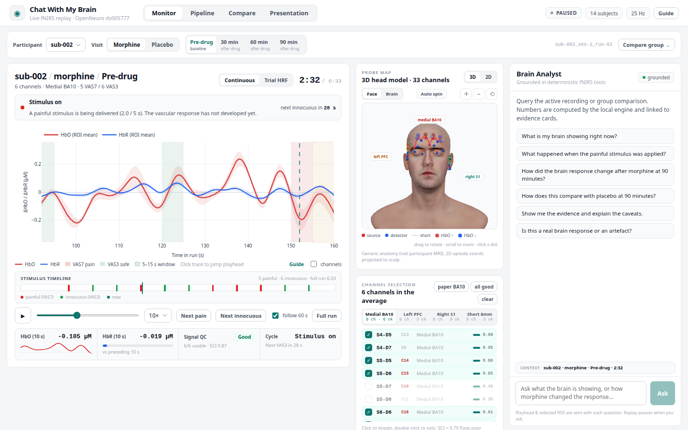
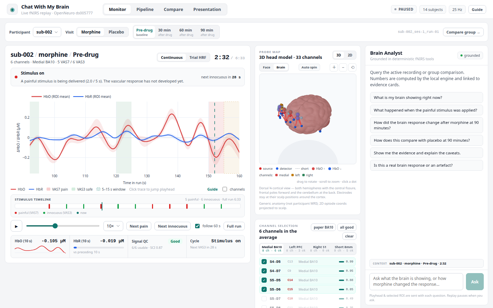
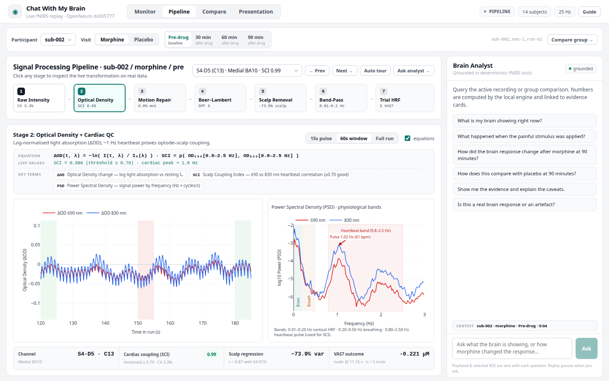
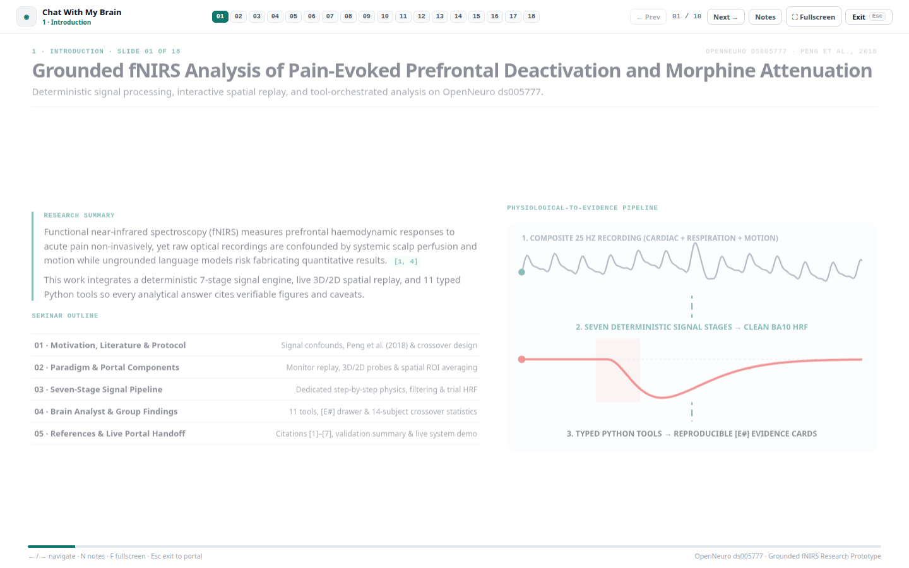

# Chat With My Brain (`brainChat`)

A grounded fNIRS research platform and interactive clinical portal built on **OpenNeuro `ds005777`** (*Electrical_Morphine_Placebo_2018*, Peng et al., 2018).

Rather than letting a language model guess from raw arrays, a deterministic Python engine handles preprocessing, quality control, trial averaging, and statistics. The LLM orchestrates **11 typed tools** and links every quantitative claim to an inspectable evidence card (`[E#]`) with a generated figure, statistical summary, and caveats.



## Portal Views

| View | Purpose |
|---|---|
| **Monitor** | Replays 25 Hz recordings (`1×–60×`) with `Continuous` traces, live browser-computed `Trial HRF`, click-to-seek, static playhead switching across visits, 4-cell telemetry (`HbO`, `HbR`, `Signal QC`, `Cycle`), and `Channel Selection` (`paper BA10`, group counts, double-click solo). |
| **3D / 2D Probes** | Synchronizes a 3D head/brain mesh (`Face` / `Brain`, auto-spin, ray-cast optodes) with spaced 2D regional mini-grids across all 33 channels. |
| **Pipeline** | Steps through all 7 processing stages (`Raw` → `OD + SCI` → `TDDR` → `Beer–Lambert` → `Short-Channel Regression` → `Band-Pass` → `Trial HRF`) with live equations, key terms, overlays, and annotated PSDs. |
| **Compare** | Visualizes 14-subject crossover statistics (`Morphine` vs. `Placebo`) via **Group Mean Time-Course** and **Paired Participant** plots (`Mean 7–10 s` and `Nadir 5–15 s`). |
| **Presentation** | Full-screen 18-slide interactive academic seminar deck (`←` / `→`, `F` fullscreen, `N` presenter cues, `Esc` exit) embedding live 3D/2D probes, animated physics diagrams, and real `sub-002` / group plots. |
| **Brain Analyst** | Tool-grounded chat sidebar with expandable `Tool Trace`, clickable `[E#]` Evidence Drawer, and principled refusal on unsupported diagnostic queries. |

| 3D Brain Mesh (`Face` / `Brain`) | 2D Regional Mini-Grid |
|---|---|
|  |  |

| 7-Stage Pipeline Explorer | Academic Presentation Mode |
|---|---|
|  |  |

> **Anatomy note:** 3D views project recorded 2D coordinates onto generic assets (Lee Perry-Smith head, CC BY 3.0; Innerscene brain, CC0 — see [`frontend/public/models/ATTRIBUTION.md`](frontend/public/models/ATTRIBUTION.md)), not participant MRI.

---

## Key Findings in This Reanalysis

| Analysis | Result |
|---|---|
| Pre-drug `VAS7` → medial BA10 (`7–10 s`) | `−0.091 µM`, `n = 12`, `t = −3.17`, `p = 0.009` |
| Shuffled-onset negative control (`500` perms) | True `−0.071 µM` vs. null `+0.003 µM`, `p = 0.002` |
| Morphine `pre → 90 min` (`Mean 7–10 s`) | `+0.108 µM`, `95% CI [0.035, 0.185]`, `p = 0.018`, `q = 0.055`, `d_z = 0.80` |
| Placebo `pre → 90 min` (`Mean 7–10 s`) | `−0.013 µM`, `p = 0.80`, `n = 13` |
| Morphine − Placebo at `90 min` | `+0.073 µM`, `95% CI [−0.0004, 0.147]`, `p = 0.094`, `q = 0.375` |

Within-morphine attenuation peaks at **90 min** in this short-channel pipeline rather than the **60 min** emphasized by Peng et al. (2018), while the direct morphine-vs-placebo contrast remains trend-level after BH-FDR correction. See [`docs/VALIDATION.md`](docs/VALIDATION.md) for sensitivity checks and BIDS timestamp caveats.

---

## Quick Start (Docker Compose)

```bash
# 1. Configure LLM credentials (never commit .env)
cp .env.example .env

# 2. Build multi-stage image (Node 22 Vite UI -> Python 3.12 FastAPI)
docker compose build

# 3. Download OpenNeuro ds005777 (~0.9 GB) and precompute cache (~1–2 min)
docker compose run --rm app python scripts/download_data.py
docker compose run --rm app python -m backend.cli build-cache

# 4. Start the portal at http://localhost:8000
docker compose up -d
```

Useful commands:
```bash
curl http://localhost:8000/api/health
docker compose run --rm --no-deps app pytest -q
```

---

## Local Development

```bash
# Backend
python3 -m venv .venv && source .venv/bin/activate
pip install -r requirements.lock.txt
cp .env.example .env
python scripts/download_data.py --dest ./data/raw
python -m backend.cli build-cache
python -m backend.cli serve --port 8000

# Frontend (separate terminal, Vite dev server on :5173)
cd frontend && npm ci && npm run dev
```

## Documentation

- [`docs/METHODS.md`](docs/METHODS.md) — dataset details, 7-stage pipeline, QC, and statistics
- [`docs/CHANNELS.md`](docs/CHANNELS.md) — 33-channel montage mapped to Peng et al. (2018)
- [`docs/VALIDATION.md`](docs/VALIDATION.md) — automated tests, negative control, sensitivity, and limitations
- [`docs/RESEARCH.md`](docs/RESEARCH.md) — grounded AI literature and architectural choices
- [`docs/PORTING.md`](docs/PORTING.md) — Docker Compose deployment notes ([`architecture.txt`](docs/architecture.txt))
