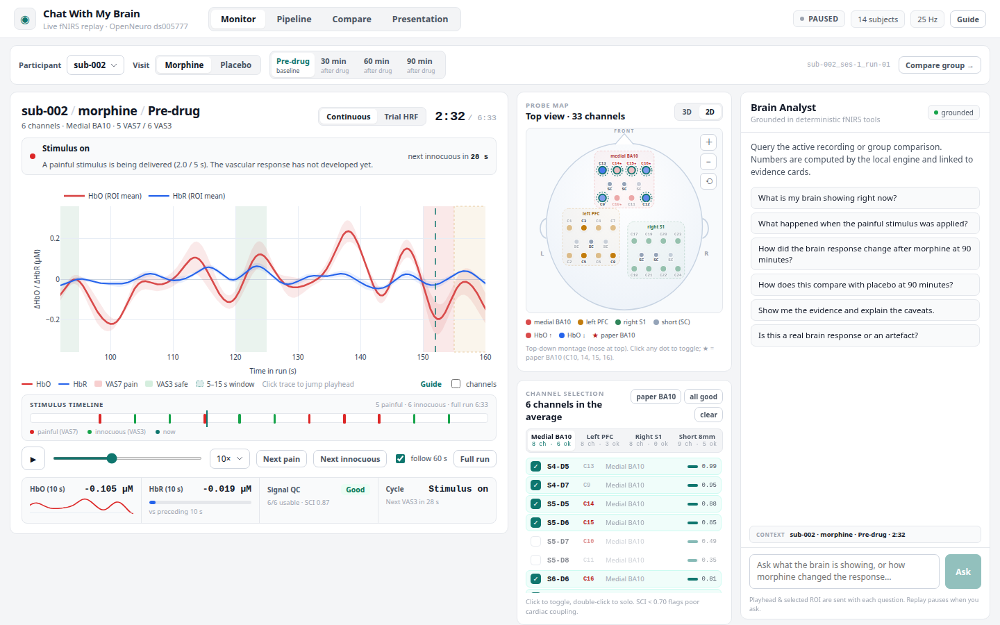

# Chat With My Brain (`brainChat`)

An interactive, grounded fNIRS research prototype and clinical signal-processing portal built on **OpenNeuro `ds005777`** (*Electrical_Morphine_Placebo_2018*, Peng et al., 2018).

The system is deliberately **not a chatbot**. A deterministic Python neuroimaging engine computes preprocessing, quality control, trial-locked HRFs, and paired statistics; an LLM orchestrates that engine through **11 typed tools**, and every quantitative claim is linked to an inspectable evidence card (`[E#]`) with a generated figure, statistical table, method summary, and caveats.


## Portal Views

| Tab | Purpose |
|---|---|
| **Monitor** | Live 25 Hz signal replay (`1×–60×`), `Continuous` vs. live browser-computed `Trial HRF` mode, click-to-seek trace, static-playhead comparison across visits/timepoints, 4-cell telemetry strip (`HbO`, `HbR`, `Signal QC`, `Cycle`), and `Channel Selection` (`paper BA10`, sensor & QC counts, double-click solo, hover channel pointers). |
| **3D / 2D Probe Map** | Synchronized 3D head/brain mesh (`Face` / `Brain` cortical toggle, auto-spin, zoom/pan, ray-cast optodes) and 2D top-down regional mini-grids (`Medial BA10`, `Left PFC`, `Right S1`, `Short 8 mm`) across all 33 channels. |
| **Pipeline** | Interactive 7-stage visual & mathematical workbench (`Raw Intensity` → `Optical Density + SCI` → `TDDR` → `Modified Beer–Lambert` → `Short-Channel Regression` → `0.01–0.20 Hz Band-Pass` → `Trial HRF`) with live equations, plain-English key terms, before/after overlays, and annotated Welch PSDs. |
| **Compare** | Group crossover statistics across all 14 volunteers (`Morphine vs. Placebo`), switching `VAS7 pain` / `VAS3 safe`, ROI, timepoint, and `Mean 7–10 s` / `Nadir 5–15 s`, with **Group Mean Time-Course** and **Paired Participant** plots. |
| **Presentation** | Full-screen 18-slide interactive academic seminar deck (`←` / `→` arrows, `F` fullscreen, `N` presenter cues, `Esc` exit) embedding live 3D/2D probe views, animated physics/signal diagrams, and real `sub-002` / group plots. |
| **Brain Analyst + `[E#]`** | Grounded tool-calling chat with expandable `Tool Trace`, clickable `[E1]` Evidence Drawer, and principled refusal on unsupported clinical diagnosis prompts. |

| 3D Brain Mesh (`Face` / `Brain`) | 2D Regional Mini-Grid |
|---|---|
|  |  |

| 7-Stage Pipeline Explorer | Academic Presentation Mode |
|---|---|
|  |  |

> **3D anatomy disclaimer:** 3D assets use generic models (Lee Perry-Smith head scan, CC BY 3.0; Innerscene brain mesh, CC0 — see [`frontend/public/models/ATTRIBUTION.md`](frontend/public/models/ATTRIBUTION.md)), not participant MRI; optodes are ray-cast onto the scalp from recorded 2D coordinates.

---

## Key Results in This Reanalysis

| Analysis | Result |
|---|---|
| Pre-drug `VAS7` → medial BA10 HbO (`7–10 s`) | `−0.091 µM`, `n = 12` subjects, `t = −3.17`, `p = 0.009` |
| Pre-drug `VAS7` nadir (`5–15 s`) | `−0.209 µM`, `t = −6.37`, `p = 0.0001` |
| Shuffled-onset negative control (`500` permutations) | True `−0.071 µM` vs. null `+0.003 µM`, `95% CI [−0.039, +0.045]`, `p = 0.002` |
| Morphine `pre → 90 min` (`Mean 7–10 s`) | `+0.108 µM`, `95% CI [0.035, 0.185]`, `p = 0.018`, `q = 0.055`, `d_z = 0.80`, `n = 12` |
| Placebo `pre → 90 min` (`Mean 7–10 s`) | `−0.013 µM`, `p = 0.80`, `n = 13` |
| Morphine − Placebo at `90 min` | `+0.073 µM`, `95% CI [−0.0004, 0.147]`, `p = 0.094`, `q = 0.375`, `n = 12` |

In this deterministic short-channel pipeline, within-morphine attenuation peaks at **90 min** rather than the **60 min** emphasized in Peng et al. (2018), and the direct morphine-vs-placebo contrast is trend-level and does not survive BH-FDR correction. See [`docs/VALIDATION.md`](docs/VALIDATION.md) for sensitivity analyses and provenance caveats (including identical timestamps in the public BIDS `scans.tsv`).

---

## Quick Start (Docker Compose)

### 1. Configure environment variables
```bash
cp .env.example .env
# Edit .env and set LLM_API_KEY (plus optional LLM_BASE_URL / LLM_MODEL)
```

### 2. Build the container image
```bash
docker compose build
```

### 3. Download dataset & build cache (one-off, ~0.9 GB)
```bash
# Download OpenNeuro ds005777 into ./data/raw/ds005777
docker compose run --rm app python scripts/download_data.py

# Preprocess all 113 SNIRF scans into ./data/processed and ./data/group
docker compose run --rm app python -m backend.cli build-cache
```

### 4. Start the application
```bash
docker compose up -d
# Open http://localhost:8000
```

Check container health and logs:
```bash
curl http://localhost:8000/api/health
docker compose logs -f
```

### 5. Run unit tests
```bash
docker compose run --rm --no-deps app pytest -q
```

---

## Local Development (Without Docker)

```bash
# Backend (Python 3.12+)
python3 -m venv .venv
source .venv/bin/activate
pip install -r requirements.lock.txt
cp .env.example .env
python scripts/download_data.py --dest ./data/raw
python -m backend.cli build-cache
python -m backend.cli serve --port 8000

# Frontend (separate terminal, Vite hot reload with /api proxy -> :8000)
cd frontend
npm ci
npm run dev
```

---

## Repository Structure

```text
brainChat/
├── Dockerfile              Multi-stage build (Node 22 Vite UI -> Python 3.12 FastAPI)
├── docker-compose.yaml     Compose service mounting ./data:/data on port 8000
├── .env.example            LLM & data path template (copy to .env; never commit .env)
├── requirements.txt        Top-level Python dependencies
├── requirements.lock.txt   Pinned Python dependencies for reproducible builds
├── backend/
│   ├── main.py             FastAPI endpoints (/api/catalog, /api/run, /api/pipeline, /api/group, /api/chat) + SPA
│   ├── agent.py            Tool-calling loop, SSE streaming, citation check
│   ├── tools.py            11 typed deterministic tools
│   ├── pipeline_viz.py     7-stage intermediate signals & Welch PSD computation
│   ├── analysis.py         Epoching, HRF metrics, paired t-tests, bootstrap CIs, BH-FDR
│   ├── preprocess.py       Raw -> OD -> TDDR -> MBLL -> 8 mm SC regression -> Band-pass
│   ├── catalog.py          OpenNeuro BIDS discovery & event normalization
│   ├── figures.py          Headless matplotlib evidence figure generator
│   ├── evidence.py         Session-scoped evidence store
│   ├── prompts.py          Boundary-aware system context pack
│   └── cli.py              CLI commands (build-cache, group, verify, serve)
├── frontend/               React 19 + TypeScript + Vite + Three.js + Plotly
├── scripts/
│   ├── download_data.py    OpenNeuro ds005777 downloader
│   └── negative_control.py 500-permutation shuffled-onset validation
├── tests/                  Pytest unit tests (pipeline & event alignment)
└── docs/                   Technical documentation & screenshots
```

## Documentation

- [`docs/METHODS.md`](docs/METHODS.md) — signal processing pipeline, QC thresholds, and statistical methods
- [`docs/CHANNELS.md`](docs/CHANNELS.md) — 33-channel optode placement cross-checked with Peng et al. (2018)
- [`docs/VALIDATION.md`](docs/VALIDATION.md) — automated tests, 500-permutation negative control, sensitivity, and limitations
- [`docs/DEMO.md`](docs/DEMO.md) — 10-minute presentation script
- [`docs/RESEARCH.md`](docs/RESEARCH.md) — grounding literature and architectural rationale
- [`docs/PORTING.md`](docs/PORTING.md) — deployment notes (`architecture.txt` diagram)

## References

- **OpenNeuro `ds005777` (v1.0.1)**: <https://openneuro.org/datasets/ds005777/versions/1.0.1>
- **Peng et al. (2018)**: *Morphine attenuates fNIRS signal associated with painful stimuli in the medial frontopolar cortex (medial BA 10).* Front. Hum. Neurosci. 12:394. <https://doi.org/10.3389/fnhum.2018.00394>
- **MNE-Python & MNE-NIRS**: Optical density, MBLL, Pollonini SCI (2014), Fishburn TDDR (2019), short-channel regression.
- **Grounded Scientific AI**: *AI Neuroscientist* (`arXiv:2609.25254`), *BrainBench* (`arXiv:2608.04156`), *NeuraDock* (`arXiv:2606.26519`).
